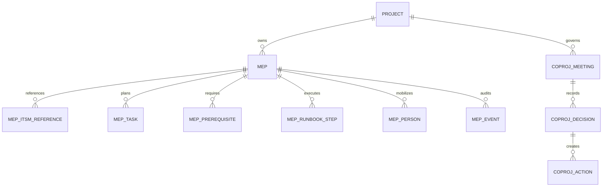
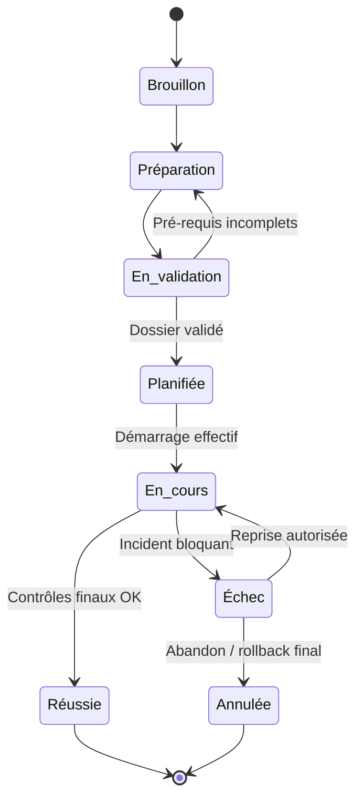

# Dossier d'implémentation – Clarity PPM 16.x / Clarity PM

**Version de conception :** 1.0  
**Périmètre :** portefeuille projets, MEP, ServiceNow manuel, COPROJ, runbooks, reporting  
**Volume cible :** 200 à 1 000 MEP/an  
**Système ITSM maître :** ServiceNow  
**Mode d'intégration :** manuel (aucun appel API ServiceNow, aucune synchronisation automatique)

> Ce dossier décrit l'implémentation dans l'application Clarity PM du dépôt `tunbest/clarity`, avec une cible fonctionnelle compatible avec un paramétrage Clarity PPM 16.x. Il ne modifie pas une instance Broadcom Clarity PPM distante : les objets, blueprints et droits de l'instance PPM réelle doivent être créés par son administrateur selon le dictionnaire ci-dessous.

## 1. Décisions d'architecture

1. Le Projet reste le parent métier et le référentiel du portefeuille.
2. Une MEP est une entité de premier niveau liée à un seul Projet.
3. Une MEP peut porter plusieurs Changes et plusieurs RITM ServiceNow.
4. ServiceNow reste maître des numéros, statuts et approbations ITSM. Clarity PM conserve des références saisies manuellement et des liens facultatifs.
5. Les tâches, jalons, prérequis, étapes d'exécution, rollback, intervenants et événements appartiennent à la MEP.
6. Les réunions COPROJ, décisions et actions de gouvernance appartiennent au Projet, pas à une MEP.
7. Aucun connecteur, webhook, polling, credential ServiceNow ou traitement de synchronisation n'est activé dans ce périmètre.
8. Les données existantes utilisant `changeNumbers` et `ritmNumbers` restent lisibles. Elles sont normalisées en références structurées lors du chargement/sauvegarde.

## 2. Modèle conceptuel et cardinalités



| Relation | Cardinalité | Contrainte |
|---|---:|---|
| Projet → MEP | 1:N | Une MEP référence un projet existant |
| MEP → Référence ITSM | 1:N | Plusieurs CHG et plusieurs RITM autorisés |
| MEP → Tâche/Jalon | 1:N | Ordre, responsable et échéance |
| MEP → Prérequis | 1:N | Validation avant GO |
| MEP → Étape de runbook | 1:N | Chronologie ordonnée |
| MEP → Intervenant | 1:N | Rôle et responsabilité |
| MEP → Événement | 1:N | Journal horodaté |
| Projet → Réunion COPROJ | 1:N | Indépendant de toute MEP |
| Réunion → Décision → Action | 1:N puis 1:N | Suivi de gouvernance |

## 3. Dictionnaire de données cible

Les noms API sont des identifiants proposés. Pour Clarity PPM 16.x, l'administrateur doit les vérifier vis-à-vis des conventions de l'instance, activer les attributs nécessaires à l'API et contrôler les capacités exactes de la version installée.

### 3.1 Projet (objet natif)

| API ID proposé | Libellé | Type | Obligatoire |
|---|---|---|---|
| `z_project_manager` | Chef de projet | Ressource | Oui |
| `z_project_sponsor` | Sponsor | Ressource/lookup | Non |
| `z_project_domain` | Domaine | Lookup | Oui |
| `z_project_service` | Service / application | Lookup | Non |
| `z_project_criticality` | Criticité | Lookup | Oui |
| `z_project_prod_owner` | Responsable production | Ressource | Non |
| `z_project_target_mep_date` | Date cible MEP | Date | Non |

Garder les champs natifs Clarity pour les dates, statut, responsable, budget, équipe, risques, tâches et jalons lorsqu'ils couvrent déjà le besoin.

### 3.2 MEP (investissement personnalisé recommandé)

| API ID proposé | Libellé | Type | Obligatoire |
|---|---|---|---|
| `z_mep_reference` | Référence MEP | Texte unique | Oui |
| `z_mep_project_id` | Projet parent | Référence/lookup | Oui |
| `z_mep_title` | Application / intitulé | Texte | Oui |
| `z_mep_version` | Version | Texte | Non |
| `z_mep_environment` | Environnement | Lookup | Oui |
| `z_mep_owner` | Pilote MEP | Ressource | Oui |
| `z_mep_priority` | Priorité | Lookup | Oui |
| `z_mep_type` | Type majeure/mineure | Lookup | Oui |
| `z_mep_status` | Statut MEP | Lookup | Oui |
| `z_mep_window_start` | Début fenêtre | Date/heure | Oui |
| `z_mep_window_end` | Fin fenêtre | Date/heure | Oui |
| `z_mep_actual_start` | Début réel | Date/heure | Non |
| `z_mep_actual_end` | Fin réelle | Date/heure | Non |
| `z_mep_go_nogo` | Décision GO/NO-GO | Lookup | Oui |
| `z_mep_go_actor` | Décideur GO | Ressource | Non |
| `z_mep_go_at` | Horodatage GO | Date/heure | Non |
| `z_mep_result` | Résultat | Lookup | Non |
| `z_mep_rollback_enabled` | Plan de rollback disponible | Booléen | Oui |
| `z_mep_rollback_triggered` | Rollback déclenché | Booléen | Oui |
| `z_mep_closure_summary` | Bilan de clôture | Texte long | Non |

Valeurs de statut : Brouillon, Préparation, En validation, Planifiée, En cours, Réussie, Échec, Annulée.  
Valeurs GO/NO-GO : En attente, GO, NO-GO.  
Valeurs résultat : Succès, Succès avec réserves, Échec, Rollback, Annulée.  
Environnements : Production, Préproduction, Recette.

### 3.3 Référence ITSM (enfant de MEP)

Chaque référence est un enregistrement indépendant. Le modèle accepte N Changes et N RITM par MEP, sans créer de relation implicite Change↔RITM.

| Attribut | Type | Règle |
|---|---|---|
| `id` | Identifiant | Unique |
| `mepId` | Référence MEP | Obligatoire |
| `type` | Enum CHANGE/RITM | Obligatoire |
| `number` | Texte | Obligatoire, unique par MEP + type |
| `status` | Texte contrôlé / statut manuel | Défaut « À vérifier » |
| `serviceNowUrl` | URL | Facultatif |
| `source` | Enum | MANUAL |
| `updatedAt` | Date/heure | Horodatage local |

Les statuts saisis sont indicatifs et manuels. L'interface doit afficher clairement « saisie manuelle – non synchronisée ». Ne pas présenter ces statuts comme une information fraîche de ServiceNow.

### 3.4 Runbook et objets enfants

| Objet | Attributs minimaux |
|---|---|
| Prérequis | id, mepId, libellé, référence/preuve, responsable, début/fin, statut |
| Étape runbook | id, mepId, ordre, libellé, référence, acteur, heure début/fin, statut, résultat |
| Étape rollback | id, mepId, ordre, libellé, acteur, heure, statut |
| Intervenant | id, mepId, nom/ressource, rôle, responsabilité, présence requise |
| Événement | id, mepId, type, étape, acteur, horodatage, commentaire |
| Tâche/jalon MEP | id, mepId, titre, type, responsable, décalage/durée, statut, liens projet facultatifs |

Statuts de prérequis/runbook : À faire, En cours, Reçu, Approuvé, Approuvé sous réserve, OK, KO, Reporté.

### 3.5 COPROJ projet

Les objets de réunion COPROJ ne doivent pas être imbriqués dans la MEP.

| Objet | Attributs |
|---|---|
| Réunion COPROJ | id, projectId, date, objet, participants, synthèse, auteur |
| Décision | id, meetingId, référence, libellé, décideur, date, statut |
| Action | id, decisionId/meetingId, libellé, responsable, échéance, priorité, statut, date de clôture |

## 4. Règles de gestion et workflows

### 4.1 Cycle MEP



### 4.2 Contrôles GO

Avant validation GO, contrôler :
- Projet parent existant.
- Au moins une référence Change saisie si la gouvernance du périmètre l'exige.
- Tous les prérequis obligatoires à l'état Approuvé ou OK.
- Runbook d'exécution renseigné et chaque étape critique affectée.
- Plan de rollback documenté et activé pour les MEP qui l'exigent.
- Fenêtre de production renseignée.
- Pilote et intervenants critiques identifiés.

**Mode manuel ITSM :** Clarity PM ne peut pas vérifier qu'un Change est réellement approuvé dans ServiceNow. Le responsable production vérifie ServiceNow, puis consigne manuellement la preuve, le statut et le lien. Une case ou un statut saisi dans Clarity n'est pas une approbation ServiceNow.

### 4.3 Règles d'exécution

- Le début réel est horodaté à l'action de démarrage.
- GO/FIN d'une étape génère un événement non ambigu avec acteur et horodatage.
- Une étape KO doit déclencher une revue de décision et rendre le risque visible.
- Le rollback ne peut être déclaré déclenché sans événement de journal.
- La clôture requiert un résultat, un bilan et la fin des actions obligatoires.
- Une MEP terminée n'est pas supprimée ; elle est conservée selon la politique d'archivage.

### 4.4 Processus COPROJ

- Création de réunion au niveau Projet.
- Saisie des participants, synthèse et décisions.
- Chaque décision peut créer plusieurs actions.
- Relance des actions échues par revue de tableau de bord et rappel manuel dans ce périmètre.
- Le CR COPROJ est indépendant du choix d'une MEP.

## 5. Vues et indicateurs

| Vue | Colonnes / filtres clés |
|---|---|
| Portefeuille projets | Code, nom, chef de projet, statut, criticité, jalon cible, santé |
| Registre MEP | Réf, projet, application/version, fenêtre, pilote, Change(s), RITM(s), GO/NO-GO, statut |
| Planning MEP | Date/heure, projet, environnement, priorité, pilote |
| Kanban MEP | Brouillon, Préparation, Validation, Planifiée, En cours, Réussie/Échec |
| Runbook | Ordre, étape, acteur, prévu/réel, statut, preuve |
| COPROJ | Projet, date réunion, décision, action, responsable, échéance |
| Direction | MEP par mois, réussite, échecs/rollback, reports, préparation, actions en retard |

KPI :
- Taux de réussite = MEP Réussies / MEP exécutées × 100.
- Taux de rollback = MEP avec rollback / MEP exécutées × 100.
- Taux de report = MEP reportées / MEP planifiées × 100.
- Préparation complète = MEP avec tous prérequis obligatoires validés / MEP en préparation ou validation × 100.
- Respect du créneau = MEP terminées dans la fenêtre / MEP exécutées × 100.
- Actions COPROJ échues = actions ouvertes dont la date d'échéance est antérieure à aujourd'hui.

Définir les exclusions (annulations préalables, MEP non démarrées) avant de publier les KPI.

## 6. Sécurité et rôles

| Rôle | Portée recommandée |
|---|---|
| Administrateur | Configuration, référentiels, comptes, audit |
| Directeur de projets | Portefeuille, arbitrage, suppression contrôlée |
| Chef de projet | Projets affectés, planning, COPROJ, actions |
| Chef de projet production / pilote MEP | Création et suivi MEP, runbook, événements |
| Contributeur | Mise à jour des tâches/étapes qui lui sont confiées |
| PMO / lecteur | Consultation et reporting selon périmètre |

Appliquer le moindre privilège, protéger les opérations destructrices, historiser les validations et tester chaque rôle avec un compte de recette.

## 7. Capacité et performance – 200 à 1 000 MEP/an

- Prévoir un identifiant stable et des index sur projet, référence MEP, date, statut et numéro ITSM.
- Paginer les listes au-delà d'un seuil raisonnable et filtrer côté serveur à mesure que le volume grandit.
- Limiter les événements conservés dans les vues rapides, tout en gardant l'historique complet en base.
- Éviter les chargements de tous les runbooks et historiques lors de l'ouverture du dashboard.
- Prévoir une sauvegarde quotidienne PostgreSQL, un test périodique de restauration et une politique de rétention.
- Contrôler les performances avec un jeu de charge représentatif d'au moins 1 000 MEP et leurs enregistrements enfants.
- Garder l'export CSV/JSON pour la portabilité, mais ne pas l'utiliser comme mécanisme de synchronisation concurrente.

## 8. Réalisation applicative et compatibilité données

### Implémentation incluse dans ce lot

- Le registre MEP accepte plusieurs numéros Change et plusieurs références RITM.
- La saisie accepte les références séparées par retours à la ligne, virgules, points-virgules ou espaces.
- À la sauvegarde, les valeurs sont normalisées en majuscules, dédupliquées et conservées dans les champs historiques `changeNumbers` et `ritmNumbers`.
- Une collection structurée `itsmReferences[]` est ajoutée à chaque MEP avec type, numéro, statut indicatif, URL facultative, source MANUAL et horodatage.
- Les anciennes sauvegardes JSON restent compatibles : les champs historiques sont transformés en références structurées au chargement.
- Le clonage d'une MEP doit réinitialiser les références ITSM pour ne pas recopier les numéros de tickets d'une ancienne exécution.
- Aucun appel ServiceNow n'est effectué. L'absence d'intégration est volontaire et visible dans la documentation.

### Contrat JSON d'une MEP (extrait)

```json
{
  "id": "MEP-ABCDE",
  "ref": "MEP-ABCDE",
  "projectId": "PROJECT-001",
  "title": "Mise en production Portail",
  "version": "4.2.0",
  "status": "Préparation",
  "changeNumbers": "CHG0048921, CHG0048922",
  "ritmNumbers": "RITM0112450, RITM0112451",
  "itsmReferences": [
    {
      "id": "ITSM-001",
      "type": "CHANGE",
      "number": "CHG0048921",
      "status": "À vérifier",
      "serviceNowUrl": "",
      "source": "MANUAL",
      "updatedAt": "2026-11-24T12:00:00.000Z"
    },
    {
      "id": "ITSM-002",
      "type": "RITM",
      "number": "RITM0112450",
      "status": "À vérifier",
      "serviceNowUrl": "",
      "source": "MANUAL",
      "updatedAt": "2026-11-24T12:00:00.000Z"
    }
  ]
}
```

## 9. Backlog technique priorisé

| ID | Chantier | Priorité | Critère de sortie |
|---|---|---|---|
| CLP-001 | Projet et gouvernance | P1 | Projet parent obligatoire, référentiels homogènes |
| CLP-002 | Investissement MEP | P1 | Fiche MEP complète et cycle de vie |
| CLP-003 | Références ITSM multiples | P1 | N Changes + N RITM, dédoublonnage, rétrocompatibilité |
| CLP-004 | Runbook / prérequis | P1 | Étapes ordonnées, responsables, preuves, statuts |
| CLP-005 | GO/NO-GO et rollback | P1 | Contrôles, journal d'audit, décision horodatée |
| CLP-006 | Sécurité | P1 | Rôles et tests de permissions |
| CLP-007 | Planning / Kanban | P1 | Filtres projet, statut, date, criticité |
| CLP-008 | COPROJ projet | P1 | Réunions, décisions, actions indépendantes des MEP |
| CLP-009 | Reporting / KPI | P2 | KPI validés, définitions et exports |
| CLP-010 | Capacité / performance | P2 | Test de charge à 1 000 MEP |
| CLP-011 | Sauvegarde / restauration | P1 | Restauration testée et documentée |
| CLP-012 | Intégration ServiceNow | Hors périmètre | Ne pas développer tant que le mode manuel reste la décision |

## 10. Plan de recette

1. Créer un projet, puis plusieurs MEP liées au projet.
2. Saisir 3 Changes et 4 RITM sur une même MEP.
3. Vérifier dédoublonnage et normalisation de la casse.
4. Charger une ancienne sauvegarde avec seulement `changeNumbers` et `ritmNumbers`.
5. Cloner la MEP et vérifier que les références Change/RITM sont vides dans la copie.
6. Vérifier que les références et statuts sont explicitement présentés comme manuels.
7. Vérifier les contrôles de préparation, GO/NO-GO et rollback.
8. Créer un COPROJ sans MEP sélectionnée et vérifier qu'il reste rattaché au Projet.
9. Vérifier les rôles et l'absence de droits excessifs.
10. Importer/exporter JSON puis comparer les enregistrements.
11. Exécuter un test de charge sur 1 000 MEP et des données enfants réalistes.
12. Tester sauvegarde et restauration PostgreSQL.

## 11. Déploiement

1. Développer et tester sur branche de travail.
2. Exécuter `npm run typecheck` puis `npm run build`.
3. Vérifier migration/rétrocompatibilité des données MEP JSON existantes.
4. Déployer via le workflow GitHub Actions existant.
5. Vérifier health-check, logs du conteneur, PostgreSQL et sauvegarde.
6. Faire une recette métier avec les rôles Projet, Production, Direction et Contributeur.
7. Publier les consignes d'utilisation et les limites du mode manuel ServiceNow.

**Limite explicite :** ce lot met en œuvre la gestion des références ServiceNow dans Clarity PM, pas un connecteur ServiceNow ni le paramétrage automatique d'une instance Broadcom Clarity PPM. Ces travaux nécessitent les accès, licences, API et environnements de l'instance cible.
